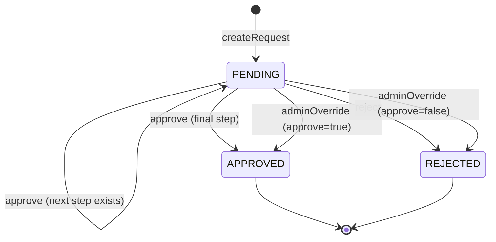

# Configurable Approval Workflow Engine

A flexible, configuration-driven approval workflow engine built with Spring Boot. It dynamically routes and executes multi-step approval workflows defined purely in database tables, without hardcoded procedural logic, conditional branching on workflow types, or static role-to-step mappings.

## Tech Stack

- Java 17
- Spring Boot 3 (v3.2.5)
- Spring Security 6 with JJWT (v0.12.6)
- Spring Data JPA / Hibernate
- H2 In-Memory Database
- JUnit 5 & Mockito
- JaCoCo (v0.8.13)

## Design and Architecture

### Config-Driven Workflow
All approval sequences are stored declaratively in the `approval_steps` table. The `WorkflowEngine` queries steps dynamically based on `(request_type, step_order)` pairs. There are zero `if/else` or `switch` statements branching on request types or roles within the engine logic.

### State Pointer
The column `requests.current_step_order` serves as a dynamic pointer indicating the active step. When an approval occurs:
- If a subsequent step exists with a greater `step_order` for that type, `current_step_order` updates to the next step while status remains `PENDING`.
- If no subsequent step exists, `status` transitions to `APPROVED` and `current_step_order` becomes `null`.
- On rejection or completion, `current_step_order` is cleared to `null`.

### State Machine



### Transactions and Concurrency
- Action methods in `WorkflowEngine` (`createRequest`, `approve`, `reject`, `adminOverride`) are `@Transactional`. Status mutations and audit log insertions commit atomically.
- Optimistic locking is enforced via `@Version private Long version` on `Request` to prevent race conditions during concurrent approval attempts.

### Security
- Stateless authentication using signed HMAC-SHA512 JSON Web Tokens (JJWT).
- User authorities are prefixed with `ROLE_` (e.g., `ROLE_REQUESTER`, `ROLE_APPROVER`, `ROLE_MANAGER`).
- Method security (`@PreAuthorize`) protects endpoints at the controller layer.
- Fine-grained business constraints (e.g., preventing creators from approving their own requests, verifying the caller possesses the current step's role) are verified inside `WorkflowEngine`.

### Audit Trail
The `approval_history` entity is marked with Hibernate's `@Immutable` annotation and has no update/delete operations. Every creation, approval, rejection, and administrative override is recorded as an append-only audit row.

## Database Schema

| Table | Columns | Constraints / Notes |
|---|---|---|
| `users` | `id` (PK), `username` (VARCHAR 50, UNIQUE), `password` (VARCHAR 100) | User account credentials |
| `user_roles` | `user_id` (PK, FK -> users.id), `role` (PK, VARCHAR 30) | User role assignments |
| `requests` | `id` (PK), `type` (VARCHAR 30), `title` (VARCHAR 200), `description` (VARCHAR 1000), `status` (VARCHAR 20), `current_step_order` (INT), `created_by` (FK -> users.id), `created_at` (TIMESTAMP), `version` (BIGINT) | Workflow request entity with optimistic lock |
| `approval_steps` | `id` (PK), `request_type` (VARCHAR 30), `step_order` (INT), `role` (VARCHAR 30) | UNIQUE(`request_type`, `step_order`) |
| `approval_history` | `id` (PK), `request_id` (FK -> requests.id), `step_order` (INT), `action` (VARCHAR 30), `action_by` (FK -> users.id), `action_at` (TIMESTAMP), `comments` (VARCHAR 500) | Append-only immutable audit trail |

## Sample Workflow Configuration

Seeded in `data.sql`:
- **LEAVE**: Step 1 -> `MANAGER`, Step 2 -> `HR`
- **EXPENSE**: Step 1 -> `MANAGER`, Step 2 -> `FINANCE`

### Adding a New Workflow via SQL Only
To add a new workflow type such as `PURCHASE_ORDER` with 3 steps (`MANAGER` -> `FINANCE` -> `DIRECTOR`), insert configuration rows into `approval_steps` without modifying Java code:

```sql
INSERT INTO approval_steps (request_type, step_order, role) VALUES
    ('PURCHASE_ORDER', 1, 'MANAGER'),
    ('PURCHASE_ORDER', 2, 'FINANCE'),
    ('PURCHASE_ORDER', 3, 'DIRECTOR');

-- Ensure at least one approver user possesses the DIRECTOR role in user_roles
INSERT INTO user_roles (user_id, role) VALUES (4, 'DIRECTOR');
```

## Running the Application

### Prerequisites
- Java 17+ JDK installed
- Maven 3.8+ (or wrapper)

### Build and Run
```bash
# Compile and run
mvn spring-boot:run
```

- Application URL: `http://localhost:8080`
- H2 Console: `http://localhost:8080/h2-console`
  - JDBC URL: `jdbc:h2:mem:workflowdb`
  - User Name: `sa`
  - Password: *(blank)*

### Run Tests and Coverage
```bash
mvn clean verify
```
JaCoCo HTML coverage report is generated at:
`target/site/jacoco/index.html`

## Test Users

Default password for all seeded users is `password123`:

| Username | Password | Roles |
|---|---|---|
| `alice` | `password123` | `REQUESTER` |
| `bob` | `password123` | `APPROVER`, `MANAGER` |
| `carol` | `password123` | `APPROVER`, `HR` |
| `dave` | `password123` | `APPROVER`, `FINANCE` |
| `admin` | `password123` | `ADMIN` |

## API Reference

| Method | Endpoint | Required Role | Description |
|---|---|---|---|
| `POST` | `/auth/login` | Permit All | Authenticates and returns JWT token |
| `POST` | `/requests` | `REQUESTER` | Submits a new workflow request (201 Created) |
| `GET` | `/requests/{id}` | `REQUESTER`, `APPROVER`, `ADMIN` | Retrieves request by ID (requester limited to own) |
| `POST` | `/requests/{id}/approve` | `APPROVER` | Approves request at the active step |
| `POST` | `/requests/{id}/reject` | `APPROVER` | Rejects request and halts workflow |
| `POST` | `/requests/{id}/override` | `ADMIN` | Force approves or rejects pending request |
| `GET` | `/requests/history/{id}` | `REQUESTER`, `ADMIN` | Retrieves audit history (creator or admin only) |

### cURL Walkthrough

1. **Log in as Alice (Requester)**
```bash
curl -X POST http://localhost:8080/auth/login \
  -H "Content-Type: application/json" \
  -d '{"username":"alice","password":"password123"}'
```

2. **Create a Leave Request**
```bash
curl -X POST http://localhost:8080/requests \
  -H "Authorization: Bearer <ALICE_TOKEN>" \
  -H "Content-Type: application/json" \
  -d '{"type":"LEAVE","title":"Vacation","description":"Trip"}'
```

3. **Approve as Bob (Manager - Step 1)**
```bash
# Login as Bob
curl -X POST http://localhost:8080/auth/login \
  -H "Content-Type: application/json" \
  -d '{"username":"bob","password":"password123"}'

# Approve Step 1
curl -X POST http://localhost:8080/requests/1/approve \
  -H "Authorization: Bearer <BOB_TOKEN>" \
  -H "Content-Type: application/json" \
  -d '{"comments":"Manager approved"}'
```

4. **View Audit History as Alice**
```bash
curl -X GET http://localhost:8080/requests/history/1 \
  -H "Authorization: Bearer <ALICE_TOKEN>"
```

5. **Admin Override**
```bash
# Login as Admin
curl -X POST http://localhost:8080/auth/login \
  -H "Content-Type: application/json" \
  -d '{"username":"admin","password":"password123"}'

# Override
curl -X POST http://localhost:8080/requests/2/override \
  -H "Authorization: Bearer <ADMIN_TOKEN>" \
  -H "Content-Type: application/json" \
  -d '{"approve":false,"comments":"Administrative rejection"}'
```

## Error Handling

Standardized JSON error envelope:
```json
{
  "timestamp": "2026-11-03T10:47:28.727Z",
  "status": 422,
  "error": "Unprocessable Entity",
  "message": "Unknown request type: FOO"
}
```

| HTTP Status | Error Name | Trigger Condition |
|---|---|---|
| `400` | Bad Request | Validation errors (e.g., blank title/type) or unreadable JSON |
| `401` | Unauthorized | Missing or expired/invalid JWT token, or bad login credentials |
| `403` | Forbidden | Insufficient role, creator attempting self-approval, or unauthorized history read |
| `404` | Not Found | Target request ID does not exist |
| `409` | Conflict | Invalid state transition (e.g., actioning non-pending request) or optimistic lock failure |
| `422` | Unprocessable Entity | Unknown request type with no defined workflow steps |

## Testing

The suite includes:
- Unit tests using JUnit 5 and Mockito (`WorkflowEngineTest`, `JwtServiceTest`) testing state transitions, permissions, claims extraction, tampering, and edge cases.
- Full end-to-end integration tests using Spring Boot Test and MockMvc (`WorkflowFlowIntegrationTest`) covering complete multi-user scenarios and security enforcement.
- Automated JaCoCo coverage enforcement on `mvn clean verify` (configured for >= 80% line coverage; current overall line coverage is **93.17%**).

## Assumptions and Future Improvements

- **Password Storage**: Seeded users use Spring Security delegating encoder with `{noop}` plaintext for demo simplicity; production environments should enforce BCrypt/Argon2 password hashing.
- **Pagination & Filtering**: Current endpoints return individual entities; listing endpoints (`GET /requests`) with pagination, sorting, and status filtering should be introduced for large volumes.
- **Token Lifecycle**: Short-lived JWTs can be paired with refresh token rotation and revocation blacklists stored in Redis.
- **Parallel Approvals**: Workflows currently follow linear ordering; future iterations could support parallel approval steps (quorum or all-of-N criteria) per order level.
- **Notifications & Webhooks**: Event listeners for workflow state transitions (approval requested, approved, rejected) to notify users via email or webhooks.
