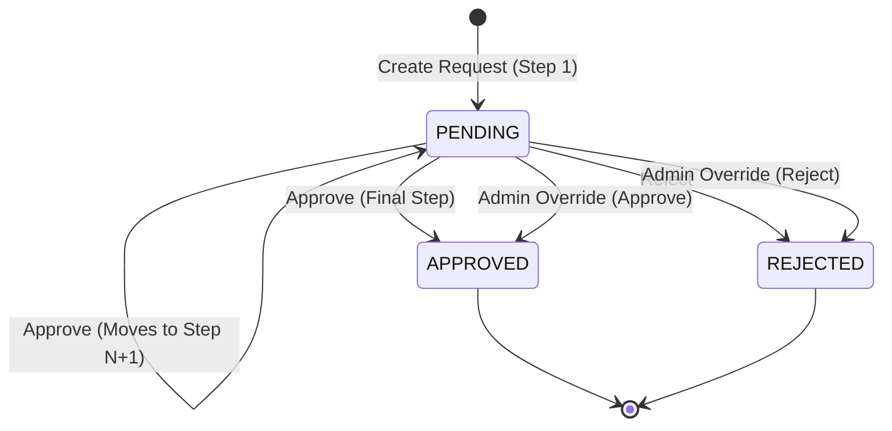

# Approval Workflow Engine

A database-driven multi-step approval workflow engine built with Spring Boot.

## Tech Stack
- Java 17
- Spring Boot 3.3.5
- Spring Data JPA
- Spring Security
- Spring Validation
- H2 In-Memory Database
- Lombok
- JJWT 0.12.6
- SpringDoc OpenAPI 2.6.0
- JaCoCo (code coverage >= 80%)

## Design Explanation
- DB-driven steps: Approval steps are defined entirely in the `approval_steps` database table. Adding or modifying workflows requires only inserting or updating database rows with zero code changes or if-else conditions.
- Current step pointer: The `current_step_order` column on `requests` acts as an integer state pointer indicating which approval step is pending. Once all steps are completed or if rejected, `current_step_order` is set to null.
- Transactional integrity: All workflow mutations in `WorkflowService` are annotated with `@Transactional` to guarantee atomic state transitions and audit logging.
- Security architecture: Stateless JWT authentication paired with `@PreAuthorize` role-based access control. The service layer performs an additional dynamic step-role check comparing the user's assigned roles against the DB-configured role for the current step.
- Immutable history: The `approval_history` table is append-only and mapped as `@Immutable` in Hibernate to prevent tampering with historical audit records.



## Database Schema
- users: id (BIGINT PK), username (VARCHAR UNIQUE), password (VARCHAR)
- user_roles: user_id (BIGINT FK), role (VARCHAR) [Composite PK: (user_id, role)]
- requests: id (BIGINT PK), type (VARCHAR), title (VARCHAR), description (VARCHAR), status (VARCHAR), current_step_order (INT), created_by (BIGINT FK users), created_at (TIMESTAMP)
- approval_steps: id (BIGINT PK), request_type (VARCHAR), step_order (INT), role (VARCHAR) [UNIQUE (request_type, step_order)]
- approval_history: id (BIGINT PK), request_id (BIGINT FK requests), step_order (INT), action (VARCHAR), action_by (BIGINT FK users), action_at (TIMESTAMP), comments (VARCHAR)

## Sample Workflow Configuration

### Seed Workflows
- LEAVE: Step 1 -> MANAGER, Step 2 -> HR
- EXPENSE: Step 1 -> MANAGER, Step 2 -> FINANCE

### Adding a Workflow with SQL Only
To add a new `PURCHASE_ORDER` workflow requiring MANAGER -> FINANCE -> DIRECTOR approval:
```sql
INSERT INTO approval_steps (request_type, step_order, role) VALUES ('PURCHASE_ORDER', 1, 'MANAGER');
INSERT INTO approval_steps (request_type, step_order, role) VALUES ('PURCHASE_ORDER', 2, 'FINANCE');
INSERT INTO approval_steps (request_type, step_order, role) VALUES ('PURCHASE_ORDER', 3, 'DIRECTOR');
```
Note: Ensure at least one user is assigned the `DIRECTOR` role in `user_roles` so that step 3 can be approved:
```sql
INSERT INTO user_roles (user_id, role) VALUES (2, 'DIRECTOR');
```

## Running the Application
- Run application: `mvn spring-boot:run`
- H2 Console: `http://localhost:8080/h2-console` (JDBC URL: `jdbc:h2:mem:workflowdb`, Username: `sa`, Password: empty)
- Swagger UI: `http://localhost:8080/swagger-ui.html`
- OpenAPI Docs: `http://localhost:8080/v3/api-docs`
- Run tests and verify coverage: `mvn clean verify`
- JaCoCo coverage report: `target/site/jacoco/index.html`

## Test Users
| Username | Password | Roles |
|---|---|---|
| alice | password123 | REQUESTER |
| bob | password123 | APPROVER, MANAGER |
| carol | password123 | APPROVER, HR |
| dave | password123 | APPROVER, FINANCE |
| admin | password123 | ADMIN |

## API Endpoints
| Method | Endpoint | Required Role | Description |
|---|---|---|---|
| POST | /auth/login | Public | Authenticate and obtain JWT token |
| POST | /requests | REQUESTER | Create a new workflow request |
| GET | /requests/{id} | REQUESTER, APPROVER, ADMIN | View request details |
| POST | /requests/{id}/approve | APPROVER | Approve current step (must have step role) |
| POST | /requests/{id}/reject | APPROVER | Reject request (must have step role) |
| POST | /requests/{id}/override | ADMIN | Force approve or reject request |
| GET | /requests/history/{id} | REQUESTER, ADMIN | View audit history for request |

## Error Codes
| Status Code | Error | Scenario |
|---|---|---|
| 400 | Bad Request | Validation failures on request payload |
| 401 | Unauthorized | Missing or invalid JWT token, or bad login credentials |
| 403 | Forbidden | User lacks endpoint role, step role, or is acting on own request |
| 404 | Not Found | Request, step, or user resource does not exist |
| 409 | Conflict | Invalid state transition (e.g. approving a non-pending request) |
| 422 | Unprocessable Entity | Unknown workflow request type |
| 500 | Internal Server Error | Unexpected generic server errors |

## Test Coverage
JaCoCo line coverage target is >= 80%.
Current line coverage: 95% (277/291 lines covered)

## Assumptions
- Swagger UI and OpenAPI documentation endpoints are permitted publicly for development and testing convenience only.
- Passwords use `{noop}` prefixes for demonstration and testing simplicity. In production, password hashing like BCrypt should be enforced.
